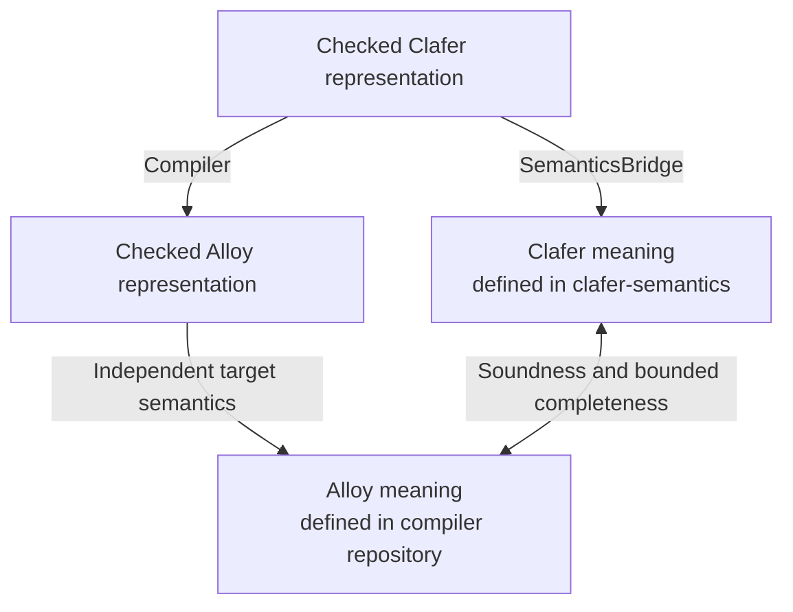

# Clafer Compiler Lean

[](https://github.com/kbak/clafer-compiler-lean/actions/workflows/ci.yml)
[](https://deepwiki.com/kbak/clafer-compiler-lean)

A structural [Clafer](https://www.clafer.org/)-to-Alloy compiler written in Lean 4,
with machine-checked preservation proofs for its supported model representations.
Clafer combines class and feature modeling: declarations describe objects,
containment, references and inheritance, while constraints restrict valid models.

The compiler accepts Clafer source or a guarded resolved-IR format and emits
static Alloy with explicit bounds. Compilation does not run a solver.

[Documentation](docs/intent.md#documentation-map) · [Contributing](CONTRIBUTING.md) ·
[Issues](https://github.com/kbak/clafer-compiler-lean/issues) · [MIT license](LICENSE)

## Purpose and verification

This project connects the independent mathematical specifications in
[Clafer Semantics](https://github.com/kbak/clafer-semantics) to a working native
compiler. Its purpose is to establish which valid configurations the translation
preserves, under which assumptions, using machine-checked proofs and execution
tests. The compiler and proofs provide a reference for future implementations
and a practical example of building software against formal specifications.



The diagram shows the in-memory proof boundary for supported inputs. Preservation
has explicit representation, scope, observation and numeric-range assumptions;
see the [composed proof contract](docs/pipeline.md#composed-assurance).
Parser and external execution limits are described under
[assurance and validation](#assurance-and-validation).

See [what the experiment establishes](docs/lessons.md) for the main findings,
potential reuse and evidence-based comparison with the Haskell compiler.

## Supported scope

| Capability | Contract |
| --- | --- |
| Declarations, cardinalities, containment, set/bag references and selected inheritance | [Structural encoding](docs/structural-encoding.md), [inherited realization](docs/inherited-realization.md) |
| Boolean logic, sets/relations, navigation, finite quantifiers, cardinality and integer addition/subtraction | [Static expressions](docs/expressions.md) |
| Source parsing, checked resolution/defaults and typed constraint elaboration | [Source pipeline](docs/pipeline.md) |
| Native source and resolved-IR commands, diagnostics and explicit bounds | [CLI](docs/cli.md) |
| Complete supported Appendix 6 telematics model and reproducible validation | [Pipeline evidence](docs/pipeline.md), [qualification](docs/qualification.md) |

[Clafer Semantics](https://github.com/kbak/clafer-semantics) supplies independent
source meanings and reusable proofs as a commit-pinned Lake dependency. The
[Haskell compiler](https://github.com/gsdlab/clafer) guides syntax and compatibility
comparisons. Their roles and immutable revisions are in the [source register](docs/sources.md).

The [feature matrix](docs/architecture.md#feature-matrix) defines the exact supported
fragment. Temporal behavior, enums, runtime strings/reals, multiplication/division,
general aggregation and automatic scope inference are outside it. Full Haskell
compatibility is not promised.

## Build and compile

Install Elan, Git, Python 3.11+, Bash and a C toolchain. The repository pins
Lean 4.35.0 and its dependency graph. Fetch and build those dependencies, then
build the compiler:

```sh
bash scripts/prepare_dependencies.sh
lake build clafer-compiler
.lake/build/bin/clafer-compiler --version
```

Compile the included telematics model using its explicit bounds:

```sh
.lake/build/bin/clafer-compiler compile-source tests/fixtures/constraints/telematics.cfr \
  --bounds tests/fixtures/pipeline/telematics.bounds.json --output /tmp/telematics.als
```

Open the generated file in Alloy to explore bounded instances. The [CLI guide](docs/cli.md)
explains bounds, the `compile-ir` command, stdin/stdout and diagnostics. A built
binary needs only the [native runtime](docs/cli.md#native-runtime), without Lean,
Haskell or Java installed.

## Assurance and validation

The kernel-checked results include admission, structural soundness and bounded
completeness, expression preservation, and full integer source-model composition.
They have explicit representation, scope, observation and numeric-range assumptions;
see the [proof contracts](docs/pipeline.md#composed-assurance).
Grammar-to-parser correspondence and native/serialized execution remain tested
boundaries. Finite Lean/Haskell/Alloy comparisons complement the proofs; they do
not establish unrestricted compatibility or unbounded unsatisfiability.

Contributions run the full build, kernel and axiom audits, native regressions,
pinned external comparisons and IntentBond checks. Follow [setup and validation](CONTRIBUTING.md#setup-and-validation)
for the additional tools and evidence requirements. Work is selected through
issues and manual intake; review precedes acceptance.
