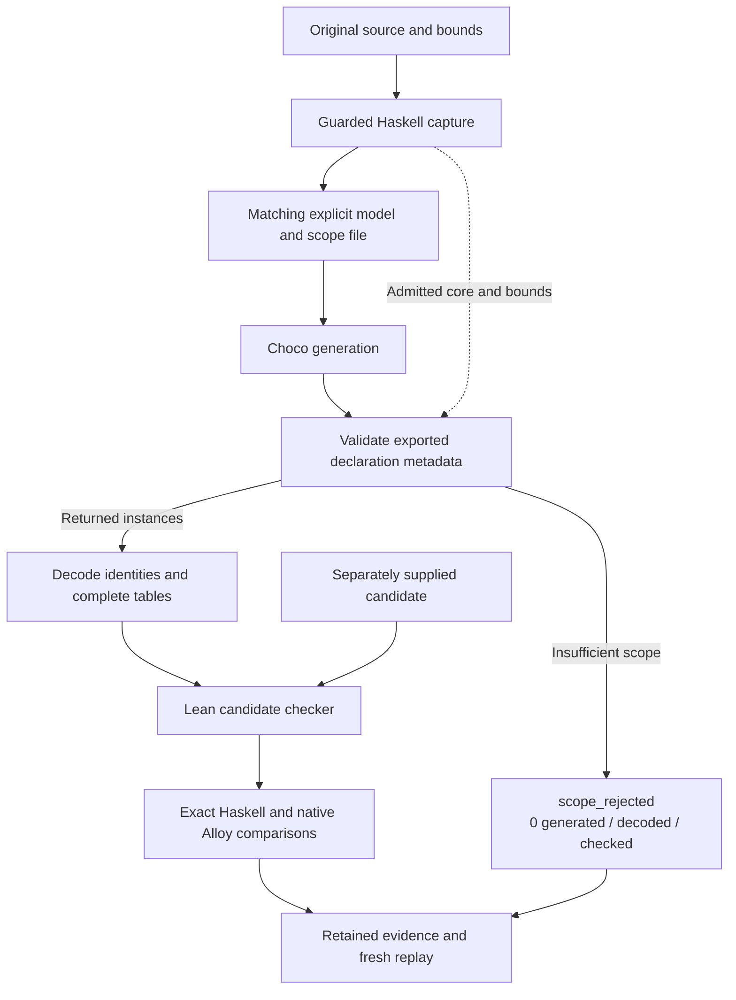
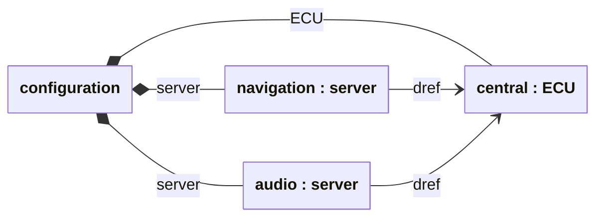

# Choco adapter and execution reference

Technical companion to [Checking Choco output](choco.md). This page records
provisioning, extraction, exact comparison and replay.

## Setup

Complete the [existing dependency and oracle setup](../CONTRIBUTING.md#setup-and-validation).
Keep the structural capture build cache: the companion needs the pinned Haskell
library as well as the capture executable. Install Maven and a Java 21 **JDK**;
a Java runtime without `javac` is insufficient. Keep Alloy on its provisioned
Java 17 runtime. All paths below are external work directories chosen by the user:

```sh
choco_work=$(mktemp -d)
git clone https://github.com/gsdlab/chocosolver.git "$choco_work/source"
git -C "$choco_work/source" checkout --detach 253b1de60e4d87435874db81a5151dca53ee1871
# Set JAVA21_HOME to the installed Java 21 JDK.
# Set CLAFER_CAPTURE_BUILD_CACHE to the directory containing the static build.json.
python3 scripts/comparison/choco_build.py --static-tools "$CLAFER_ORACLE_TOOLS" \
  --capture-cache "$CLAFER_CAPTURE_BUILD_CACHE" --choco-source "$choco_work/source" \
  --java-home "$JAVA21_HOME" --maven-cache "$choco_work/maven" "$choco_work/tools"
export CLAFER_CHOCO_TOOLS="$choco_work/tools/tools.json"
```

Provisioning checks immutable source identities, builds the unchanged upstream
library, compiles the extraction bridge and explicit companion, and retains JAR,
JDK, dependency, source and build identities plus licenses and notices. Caches
containing only the capture binary use a separate library build so the accepted
static executable and receipt remain intact.
Choco's own test suite is not run by this provisioning command; the adapter's
actual-generation tests run in the full compiler check. Reprovision after changing
an adapter build source. Missing tools fail qualification rather than skip it.

## Run and inspect

After building the existing comparison harness, one command runs the exercise:

```sh
lake build
lake build +tests.ComparisonNative
python3 scripts/comparison/choco.py demo --tools "$CLAFER_CHOCO_TOOLS" "$choco_work/run"
```

Use a fresh output directory. When using Lake's optional artifact cache, export
`LAKE_RESTORE_ARTIFACTS=true` so the harness can import restored modules.

| Case | Choco generation | Supplied candidate check |
| --- | --- | --- |
| Bag: both servers refer to `central` | One instance; checker accepts | Identical supplied configuration passes |
| Set: both servers would refer to `central` | `InsufficientScopeException`: one ECU is below the required two; no instance returned | The shared-ECU configuration violates set uniqueness; both exact Alloy queries reject it |
| Set: the servers refer to separate ECUs | Generated instances use distinct ECUs; checker accepts | Generated configuration also passes both exact Alloy comparisons |
| Remove `audio` | Deliberately supplied mutation | Violates the requirement for exactly two servers |
| Remove `audio`'s reference to `central` | Deliberately supplied mutation | Violates the requirement that each server has a target |

The one-target set result is `scope_rejected`, retaining Choco's diagnostic. It is
neither solver UNSAT nor a candidate verdict. `generated`, `decoded` and `checked`
count only returned instances; the separately named `supplied` results show that
the negative set candidate was actually checked. `exhausted` means that Choco's
bounded search ended; `limit` means the selected instance cap stopped enumeration.
Neither is a completeness or unbounded-UNSAT result. `completed` means every
returned candidate has a completed agreeing exact comparison, including a
possible `violates` verdict; the demonstration separately requires positive
controls to satisfy. The decoder never discards rejected instances.

Each case retains original input, accepted capture, same-generation explicit
output and scope file, complete parsed declarations, raw `raw.xml`, source/tool
identities and generated/decoded/checked counts. Each `instance-N/` contains the
candidate, declaration/local-ID-to-object map, complete tables including empty
ones, checker verdict and the existing `exact/` three-way comparison bundle.
The synthetic root has object ID `0`; sorted declaration/local-ID pairs receive
fresh numeric IDs. All parent and reference endpoints use that same map. Abstract
memberships follow the checked declaration super chain, without changing object
identity. No display string is parsed and no equal-target heads are merged.

Replay a case, including its retained exact candidates:

```sh
python3 scripts/comparison/choco.py replay --tools "$CLAFER_CHOCO_TOOLS" \
  "$choco_work/run/bag" "$choco_work/bag-replay"
```

The manifest detects changed, missing and extra bundle files. Replay also checks
current adapter and runtime identities before generation. The existing exact
comparison replay rechecks each retained original candidate independently of the
new search's object ordering. Individual `supplied-*` bundles also support the
[existing exact comparison replay](comparison.md#replay-search-and-minimization).

`check INPUT --bounds BOUNDS OUTPUT --tools TOOLS` accepts another source only
through the same guarded admission and complete metadata comparison. Arithmetic,
constraints, temporal input, backend escapes and authored option directives stay
unsupported. Behavioral support requires a separate integration decision. Decoder
format failures are `malformed`; failed tools are `error`; wall-clock expiry is
`timeout`. These outcomes cannot establish agreement. The
[regression suite](../tests/test_choco_instances.py) also exercises nested and
inherited identities, reference cycles, malformed metadata/objects, a rejected
returned instance, actual process failures and replay tampering.

## How an instance reaches the checker

The adapter keeps the original model alongside the explicit Choco input so the
checker can judge the returned configuration against that same model. After
checking, exact Alloy queries provide a further comparison on the same candidate.



The scope-rejection branch returns no instances to check. The separately supplied
shared-target set candidate still reaches the checker and receives a violating verdict.

## Adapter assessment

The selected structural adapter reuses the accepted Haskell 0.5.7 capture,
guarded candidate protocol, Lean checker and exact Alloy comparison. Choco's
`ExplicitParser`, `ScopeFile`, `ClaferCompiler` and `InstanceModel` supply parsing,
scope application, solving and instance extraction. No new source parser, solver,
semantic checker or graph-isomorphism implementation is needed.

The saved fixture uses `Target` for `ECU` and `refs` for `server`.
At Choco revision `253b1de60e4d87435874db81a5151dca53ee1871`, the API probe for
`Target` followed by `refs ->> Target 2..2` returned one instance. The mapping is:

| Explanatory object name | Choco (declaration UID, local ID) | Checker object ID | Reference target |
| --- | --- | --- | --- |
| configuration | added by the adapter | `0` | none |
| `central : ECU` | (`Target`, `0`) | `1` | none |
| `navigation : server` | (`refs`, `0`) | `2` | `central` |
| `audio : server` | (`refs`, `1`) | `3` | `central` |

The diagram shows those same objects with UML-style composition for containment
and directed associations for references. The diamond is at the container end.
The two `server` objects remain separate throughout extraction and checking.
`dref` denotes following the reference declared by `->>`; see the
[guide notation](instance-checks.md#what-is-being-checked-two-references-to-one-ecu).



`InstanceClafer.getType()` and `getId()` identify an occurrence together;
`getChildren()` supplies containment and `getRef()` returns the target object.
`ClaferSolutionMap` uses the same declaration/ID pair internally, including lazy
resolution of reference cycles. Display names and `toString()` are unnecessary.
The library omits the synthetic source root, complete empty tables and source
capture receipts. A small external exporter and decoder must supply those and
check the complete parsed declaration metadata against the admitted source core.
No upstream change is needed for this exercise.

The existing static exporter does not retain explicit output. A companion calls
the pinned Haskell `genExplicitModule` on the same analyzed environment with the
declared experiment bounds. It reuses the existing source audit and effective
options, and compares the IR, JSON and Alloy bytes with the accepted capture.
Original source is admitted before printing; the generated `//# OPTIONS --explicit`
directive belongs only to the Choco input. Existing source-directive rejection
remains in force. Explicit bytes, scope sidecar and effective options are retained
from that companion generation.

The JDK XML writer and Python `xml.etree.ElementTree` provide the transport;
Python's existing JSON, subprocess and hashing support provides receipts and
replay. These standard libraries avoid another serialization dependency. Choco
and Haskell retain their MIT licenses; Choco's declared Maven dependencies and
their notices are retained with the external build. Java 21 is needed for Choco;
the existing Alloy Java 17 profile remains separate. Neither extraction nor
external parsing, native execution or solver operation is a kernel proof.
