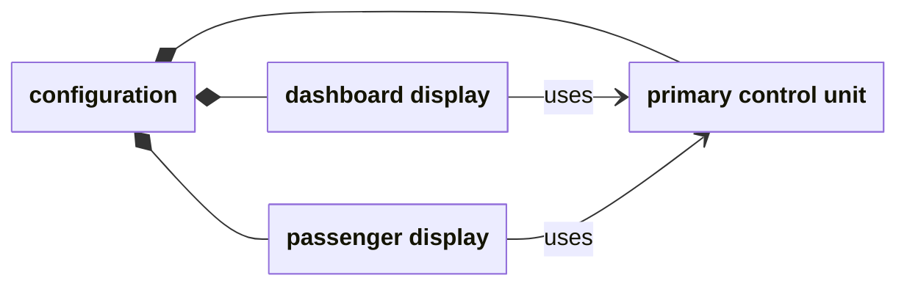

# Check Choco's generated instances

The [instance guide](instance-checks.md) checks configurations against Clafer's
formal rules and two Alloy translations. We can also ask a different generator
to produce configurations, then apply the same semantic checker. This guide
uses the Java Choco backend.

## What each tool contributes

Haskell first resolves the Clafer model and produces an **explicit model**: names
and omitted defaults have been worked out. Choco's Java parser reads that model,
and Choco searches for configurations. The Lean checker then checks each returned
configuration against the formal Clafer rules.

The adapter between Choco and the checker preserves the objects, their types,
containment and references. That matters because checking a changed configuration
would tell us nothing about Choco's actual answer. We also ask both Alloy
translations about the same candidate, as in the instance guide.

## Two displays, one control unit

Use a dashboard display and a passenger display connected to a control unit.
This time the model requires exactly two displays:

```clafer
ControlUnit
display ->> ControlUnit 2..2
```

Choco returns a configuration with both displays using the same unit:



The filled diamonds show containment; `uses` arrows show references. The Lean
checker accepts because there are exactly two displays, both links reach an
existing control unit, and `->>` permits sharing it. Both Alloy comparisons
accept this same configuration.

Now change the model's reference kind to `->`, which requires the displays to
use different units. Two outcomes need to be distinguished:

- **Generating:** with room for only one control unit, Choco refuses the search
  bounds before producing a configuration. There is no generated instance to check.
- **Checking:** we can still hand the shared-unit configuration directly to the
  Lean checker. It rejects it because the two displays use the same unit.

To get a passing set case, change the declaration to `ControlUnit 2..2` and give
Choco room for both units. Each display then uses a different unit. Both Alloy
translations accept that generated configuration too.

## Can the checker notice lost information?

An adapter could accidentally merge two displays because they use the same
control unit, or lose one of their links. We deliberately damage a copy of the
valid bag configuration to see whether the checker notices:

| Change to the candidate | Which rule fails? |
| --- | --- |
| Remove the passenger display | The model requires exactly two displays; only one remains |
| Keep both displays but remove the passenger display's `uses` link | Every display must refer to a control unit; one has no target |

The checker rejects both. The distinction is useful: two references to one
unit are still two separate objects, and preserving only the set of target units
would lose information that the model constrains.

## What this exercise establishes

We have checked real Choco output and shown that specific invalid configurations
are rejected. That is evidence about these examples, not a proof of the Choco
backend or of its Java parser. The current adapter covers the selected structural
models; integer constraints and temporal behavior require their own checking paths.

Haskell's role here is to prepare the explicit input. Choco generates the
configuration. The Lean semantic checker supplies the independent judgment
about that configuration's meaning.

## Try the example

After [setting up the Choco tools](choco-adapter.md#setup), run:

```sh
lake build
lake build +tests.ComparisonNative
choco_demo=$(mktemp -d)
python3 scripts/comparison/choco.py demo --tools "$CLAFER_CHOCO_TOOLS" "$choco_demo/run"
```

The command exercises the passing configurations, the refused one-unit set search,
and the deliberately invalid candidates described above. The
[adapter reference](choco-adapter.md) records the fixture-name mapping and integration details.
