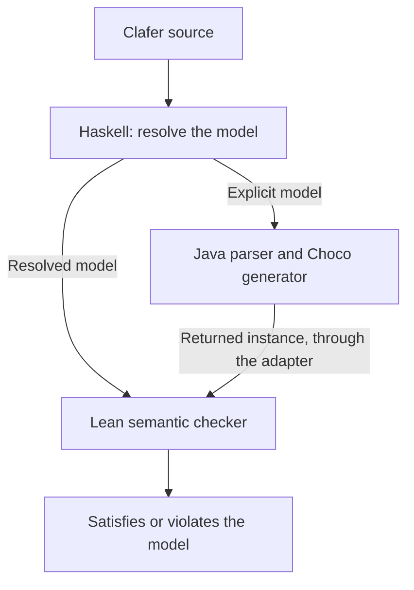

# Validate a generator with the instance checker

A useful first exercise for a compiler that reads explicit Clafer is to generate
a small configuration and check it against the formal semantics. This guide does
that with the Java Choco backend. It shows how the
[instance checker](instance-checks.md) can test a generator's actual answers.

## From the model to a checked answer

The Haskell compiler prepares an **explicit model**: names are resolved and
omitted defaults are filled in. Choco's Java parser reads that model, and Choco
searches for instances. An adapter passes each returned instance to the Lean
semantic checker, together with the resolved model it must satisfy:



The checker evaluates the instance against Clafer's formal rules. It does not ask
Choco whether its own answer is correct. The adapter retains each object's type,
identity, parent and reference target, so the check concerns the instance Choco
actually returned. The exercise also asks both the Haskell and Lean compilers'
Alloy translations about that same instance.

## Generate two references to one ECU

Use the `ECU` and `server` declarations from the instance guide, now requiring
exactly one ECU and two servers:

```clafer
ECU
server ->> ECU 2..2
```

Choco returns two `server` objects referring to the same ECU. Call the servers
`navigation` and `audio`, and the ECU `central`. These are the objects shown in the
[instance diagram](instance-checks.md#what-is-being-checked-two-references-to-one-ecu).
The checker accepts: there are exactly two servers, each has an existing ECU as
its target, and `->>` permits sharing. Both Alloy comparisons accept too.

Now change `->>` to `->`. The two servers must have different ECU targets.
The exercise distinguishes generating an answer from checking one supplied directly:

| Exercise | Result | Meaning |
| --- | --- | --- |
| Generate with `ECU` and `server ->> ECU 2..2` | An instance is returned and accepted | Two servers may share the one ECU |
| Generate with `ECU` and `server -> ECU 2..2`, allowing only one ECU in the search | Choco refuses the bounds; no instance is returned | It requires room for two distinct targets; there is no answer to check |
| Supply the shared-ECU instance directly to the checker under the set model | Rejected | It violates the distinct-target rule |
| Generate with `ECU 2..2` and `server -> ECU 2..2`, allowing two ECUs | An instance is returned and accepted | Each server has a different ECU |

For every checked instance in this table, the semantic checker and both Alloy
translations agree. Choco's refusal of the one-ECU search is a separate outcome;
it is not a checker verdict or a solver result proving that no solution exists.

## Check that mistakes are detected

A passing generated instance is only half the exercise. We also damage a copy
of it and confirm that the checker rejects the result:

| Change to the bag instance | Why the checker rejects it |
| --- | --- |
| Remove `audio`, leaving only `navigation` | The model requires two `server` objects |
| Keep `audio` but remove its reference to `central` | Every server must have a target |

This is a concrete integration test. If an adapter keeps only the set of targets,
it loses the distinction between two references to one ECU and one reference to
that ECU. The cardinality check detects that loss. The second mutation tests
whether a missing reference can slip through.

## Use this when developing the Java toolchain

The exercise already connects an explicit Java parser and Choco generator to the
formal checker. The same approach can test later compiler changes: keep the model
being checked, export the returned objects without merging or dropping them, and
check each answer. Include an invalid candidate for the rule being exercised so
that acceptance alone cannot hide a missing check.

The current adapter handles the selected structural models without constraints;
arithmetic and temporal behavior are outside this adapter. It checks exported
declaration metadata against Haskell's resolved model before checking instances.
That helps catch a mismatched interpretation of these inputs, but it is not a
general validation of the Java parser or of Haskell's resolution. Nor does checking
returned instances establish that Choco finds every valid configuration.

The [adapter reference](choco-adapter.md) describes the supported input and the
mapping needed to connect another backend. For a generator that produces
executions over time, the next concept is [trace checking](temporal-comparison.md).

## Run the exercise

After [setting up the Choco tools](choco-adapter.md#setup), run:

```sh
lake build
lake build +tests.ComparisonNative
choco_demo=$(mktemp -d)
python3 scripts/comparison/choco.py demo --tools "$CLAFER_CHOCO_TOOLS" "$choco_demo/run"
```

The command generates and checks the positive cases, records the refused search,
and checks the invalid candidates above. In its summary, `satisfies` counts
accepted generated instances; `supplied` records the separately checked
candidates. `scope_rejected` means the search bounds were refused. The
[fixture mapping](choco-adapter.md#adapter-assessment) connects the readable names
here to the saved inputs.
