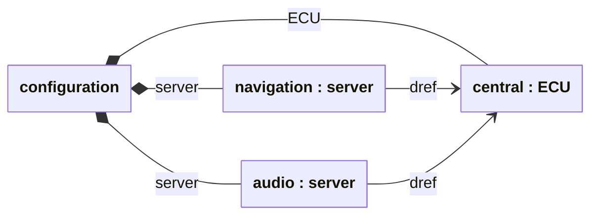

# Check a generator's answer against Clafer's semantics

Suppose a Clafer generator returns a configuration. Does that configuration
actually satisfy the model? The instance checker answers this question for the
supported parts of Clafer. It takes a representation of the model and one
candidate instance, then checks the candidate against the formal rules.

This gives a compiler developer a practical use for the
[Clafer formalization in Lean](https://github.com/kbak/clafer-semantics): test a
generator's answers without having to read or write Lean proofs first. The
[Choco exercise](choco.md) applies this to actual output from the Java backend.
Here we explain what the checker is deciding.

## How this relates to the Haskell compiler

The Haskell Clafer compiler translates a model into Alloy. The Alloy Analyzer
searches for instances satisfying that translation. If the translation omits a
rule, Alloy may return an instance that violates the original Clafer model.

The formalization defines what it means for an instance to satisfy Clafer's
rules. Its executable checker evaluates a supplied instance against those rules;
it does not generate a replacement instance. This repository also has a compiler
written in Lean, which translates models into Alloy. That compiler and the
semantic checker have different jobs.

For the first example below, we compare three answers about the **same instance**:

| Checking path | Question |
| --- | --- |
| Lean semantic checker | Does this instance obey the formal Clafer rules? |
| Haskell compiler + Alloy | Does it satisfy Haskell's translation? |
| Lean compiler + Alloy | Does it satisfy the Lean compiler's translation? |

A disagreement gives us a concrete model and instance to investigate. Deliberately
invalid instances are useful too: they show whether the checks notice a broken rule.

## What is being checked: two references to one ECU

An electronic control unit (ECU) can serve several roles in a configuration.
In this small model, each `server` names an ECU. May two `server` instances
refer to the same ECU?

```clafer
ECU 0..2
server ->> ECU 0..3
```

The model allows up to two ECUs and three `server` instances. The bag reference
`->>` allows repeated targets. Consider two servers, named `navigation` and
`audio`, both referring to an ECU named `central`:



Each box is an object; `navigation : server` means an object named `navigation`
of the declared clafer `server`. Filled diamonds show containment in the implicit
outer configuration. The notation follows the
[SoSyM paper, §4.1, Figure 6](https://gsd.uwaterloo.ca/sites/default/files/2014-Bak-Clafer-Unifying-Class-Feature-Modeling%28SOSYM%29.pdf):
a reference clafer has its own objects, and `dref` follows their reference to a
target. Here `dref` depicts the model's `->>`; it is not an additional declaration.

The checker evaluates these obligations:

| Rule from the model | What it checks in this instance |
| --- | --- |
| Declarations and containment | Both `server` objects and the `ECU` belong to the outer configuration |
| `server` cardinality `0..3` | There are two `server` objects, even though their target is shared |
| `ECU` cardinality `0..2` | There is one ECU |
| `server ->> ECU` | Each `server` has a reference to an existing ECU; sharing is allowed |

All pass. Now change only `->>` to `->`. Set references require distinct targets
for instances of the same reference clafer under the same owner. Our two servers
share a target, so this same instance fails. Giving `audio` a second ECU, named
`backup`, makes the set case pass:

| Model and candidate | Lean semantic checker | Haskell + Alloy | Lean compiler + Alloy |
| --- | --- | --- | --- |
| Bag: `navigation` and `audio` both refer to `central` | accepts | accepts | accepts |
| Set: both still refer to `central` | rejects | rejects | rejects |
| Set: `navigation` refers to `central`, `audio` to `backup` | accepts | accepts | accepts |

The rejecting row is a deliberately supplied invalid instance. Alloy calls this
exact-instance rejection **UNSAT**: this instance is not allowed. It does not
mean the model has no valid instances; the last row is one.

## Checking a value constraint

References and cardinalities are only part of a model's meaning. A configuration
may have the right structure but violate a constraint. For example, a display's
version must be at least its control unit's version:

```clafer
displayVersion -> int
controlUnitVersion -> int
[displayVersion >= controlUnitVersion]
```

The checker first checks the structure and integer representation, then evaluates
the bracketed constraint:

| Display version | Control-unit version | Constraint evaluation | Verdict |
| --- | --- | --- | --- |
| `3` | `2` | `3 >= 2` is true | accepts |
| `1` | `2` | `1 >= 2` is false | rejects |

Both candidates contain allowed integer values. The second fails specifically
because of the constraint. The Lean compiler's Alloy translation agrees on both.
This example uses the richer source pipeline; the Haskell comparison above and
the current Choco adapter cover a smaller structural profile.

The complete **telematics** example combines these ideas in a vehicle electronics
model. Its displays have a `server` reference and a `version`; the constraint
`[version >= server.version]` follows that reference before comparing values.
Other rules connect options such as dual channel and extra displays to the
required equipment. The exercise generates an instance with the Lean compiler
and Alloy, then checks its structure, values and all twelve constraints,
including the three final option selections. This is still one configuration;
[trace checking](temporal-comparison.md) adds behavior over time.

## What this can validate

For a generator developer, the useful result is a checked answer: this candidate
satisfies the supplied model, or it violates a rule. A rejected generated answer
exposes a discrepancy to investigate in the generator, translation or adapter.
Accepted examples do not prove the generator correct for every input, establish
that it finds every valid instance, or validate a claim that no instance exists.

The supplied model matters too. The small comparison uses Haskell's resolved
model as the checker input, so it does not independently validate Haskell's
parsing and name resolution. The [technical reference](instance-checks-reference.md)
records the supported profiles and proof boundaries.

To start applying this idea to a Java generator, continue with
[checking Choco's generated instances](choco.md). It shows the model input,
returned objects and expected verdicts together.

## Run these examples

After the [tool setup](../CONTRIBUTING.md#setup-and-validation), run:

```sh
lake build
lake build +tests.ComparisonNative +tests.PipelineNative
demo_dir=$(mktemp -d)
python3 scripts/demo_instances.py "$demo_dir/run"
```

Successful completion means the checks obtained the outcomes described above,
including the intended rejections. The examples use readable names here; the
[fixture mapping](instance-checks-reference.md#reference-examples) relates them to
the runnable inputs.
