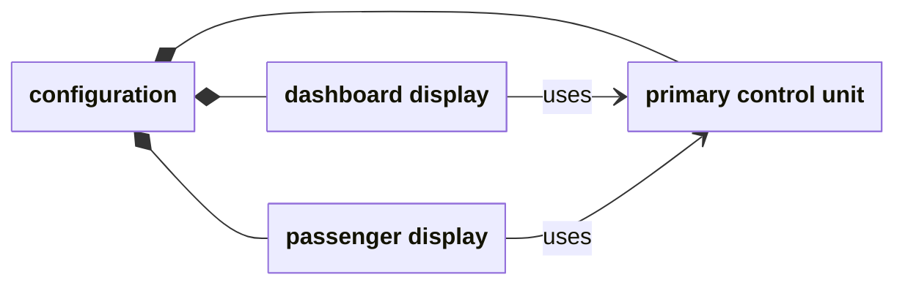
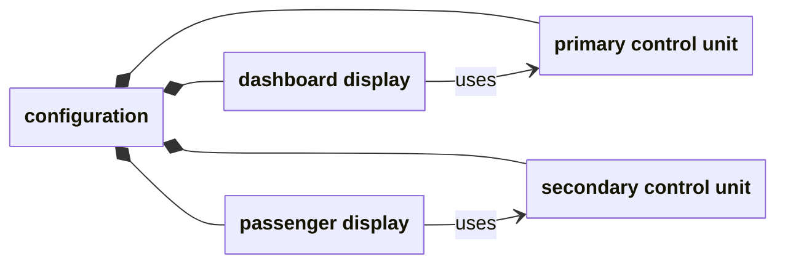

# Check whether an instance satisfies a model

A Clafer model describes allowed configurations. An **instance** is one concrete
configuration: particular objects, their relationships and their values. This
guide explains how we check that a proposed instance obeys the model.

## How Haskell, Alloy and Lean fit together

The Haskell Clafer compiler translates a Clafer model into Alloy. The Alloy
Analyzer then searches for a configuration satisfying that translation. If a
translation accidentally omits a rule, Alloy can return an answer that satisfies
the translation but violates the original Clafer model.

The [Clafer formalization in Lean](https://github.com/kbak/clafer-semantics)
defines what it means to satisfy Clafer's rules. Its executable checkers evaluate
a given configuration against those definitions. They give us an independent way
to check an answer from a generator.

There are two distinct Lean roles here:

| Component | What it does in this exercise |
| --- | --- |
| Lean semantic checker | Checks the candidate against the formal Clafer rules |
| Haskell compiler + Alloy | Checks the same candidate against Haskell's translation |
| This repository's Lean compiler + Alloy | Checks it against a second translation, implemented in Lean |

We ask all three about the **same configuration**. This matters: two generators
could each find a valid answer while disagreeing about which other configurations
are allowed. The examples below include deliberately invalid candidates so we
can see both acceptance and rejection.

## Two displays sharing a control unit

Imagine a dashboard display and a passenger display, each connected to an
electronic control unit (ECU). A reference records which control unit a display
uses. May both displays use the same one?

Clafer's **bag** form, `->>`, permits this. The **set** form, `->`, requires
references under the same owner to have distinct targets. With descriptive
names for our small example, the bag model reads:

```clafer
ControlUnit 0..2
display ->> ControlUnit 0..3
```

The ranges allow up to two control units and three displays. Consider this
configuration with two displays and one shared control unit:



The boxes are named objects. UML-style composition—a filled diamond at the
container—shows which objects belong to the configuration. The `uses` arrows
are references. Sharing a control unit does not merge the two displays.

The checker asks:

- Are the objects of the right kinds, with the required containment?
- Are there allowed numbers of them? Two displays fit `0..3`; one unit fits `0..2`.
- Does each display point to an existing control unit?
- Does the reference kind permit both displays to use that same unit?

The first three checks pass. The last one passes for `->>` and fails for `->`.
So changing only the arrow in the model changes the verdict on this exact
configuration. The failing set case is intentional; it is not a generator bug.

Give the passenger display a secondary control unit and the set passes too:



All three checking paths agree:

| Configuration and rule | Lean semantic checker | Haskell + Alloy | Lean compiler + Alloy |
| --- | --- | --- | --- |
| Both displays share a unit; bag references | accepts | accepts | accepts |
| Both displays share a unit; set references | rejects | rejects | rejects |
| Each display uses a different unit; set references | accepts | accepts | accepts |

Alloy calls these exact-candidate outcomes **SAT** and **UNSAT**. Here UNSAT means
“this particular configuration is not allowed.” It does not mean that the model
has no valid configurations—the last row is a valid set configuration.

## A rule about version numbers

Now add a requirement about values: a display's version must be at least the
version of its control unit. We can study just that rule with two integers:

```clafer
displayVersion -> int
controlUnitVersion -> int
[displayVersion >= controlUnitVersion]
```

The checker first checks the structure and integer representation, then evaluates
the bracketed constraint for those values:

| Display version | Control-unit version | Constraint evaluation | Verdict |
| --- | --- | --- | --- |
| `3` | `2` | `3 >= 2` is true | accepts |
| `1` | `2` | `1 >= 2` is false | rejects |

Both candidates use allowed integer values. The second fails because of the
version rule, not because its data is malformed. The Lean compiler's Alloy
translation agrees on both candidates. This richer example uses the source
pipeline's structure and expression checks; it is outside the small Haskell
comparison profile used for the display-reference example.

## Putting the rules together

The complete **telematics** example describes a vehicle electronics configuration
with control units, displays and options. It combines questions such as:

- Does selecting a dual channel include the second control unit?
- Does selecting extra displays give the required display counts?
- Does each display use its containing control unit as its server?
- Is each display's version at least its server's version?

The last check now follows a relationship: `[version >= server.version]` finds
the display's server and reads that server's version before comparing the values.
The two-integer example above isolated just the comparison.

The exercise compiles the complete model with the Lean compiler, asks Alloy for
a configuration, then checks its structure, values and all twelve constraints.
It also asks Alloy about that same configuration to compare the results. The
model's three selections—dual channel, extra displays and large size—are included
in those twelve constraints. This remains a check of one static configuration;
[trace checking](temporal-comparison.md) adds behavior over time.

## What this tells us

Agreement means that the formal rules and the translations agree on the tested
candidates. A generated candidate rejected by the semantic checker exposes a
discrepancy worth investigating. Neither result, by itself, proves a generator
correct for every model or shows that it finds every valid instance.

The checker judges a representation of the model and candidate supplied by an
adapter. The small Haskell comparison reuses Haskell's resolved model input, so
this exercise does not independently validate Haskell's parsing and resolution.
The [technical reference](instance-checks-reference.md) states the exact supported
profiles and proof boundaries.

The same idea can check another generator: provide the model and its candidate,
preserving every object, link and value, then apply the semantic checker. The
[Choco guide](choco.md) shows that next step.

## Try the examples

After the [tool setup](../CONTRIBUTING.md#setup-and-validation), run:

```sh
lake build
lake build +tests.ComparisonNative +tests.PipelineNative
demo_dir=$(mktemp -d)
python3 scripts/demo_instances.py "$demo_dir/run"
```

The command runs the examples above and reports their outcomes. The explanatory
names here make the situations readable; the [fixture mapping](instance-checks-reference.md#reference-examples)
relates them to the runnable inputs. No inspection of generated files is needed
to follow the checks.
