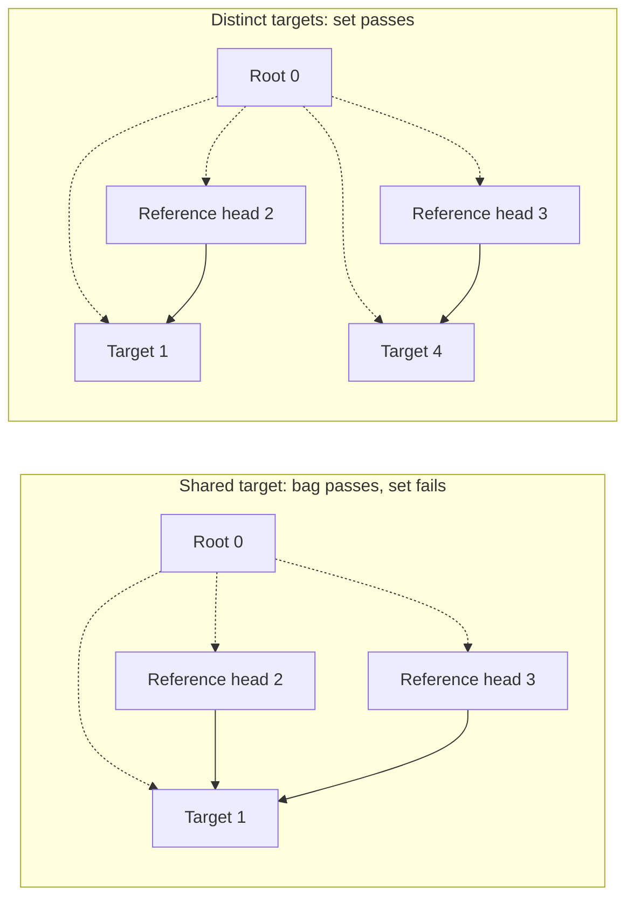

# Check Alloy instances, from small examples to telematics

Run three examples: two references sharing a target, a version comparison, and
complete static telematics. Each checks a concrete candidate and keeps the inputs,
solver results and replay data outside the repository. These examples provide a
baseline for the [Java rewrite](https://github.com/kbak/clafer-compiler-lean/issues/115)
and [Choco adapter](https://github.com/kbak/clafer-compiler-lean/issues/114).

## Run the demonstration

Complete [dependency and comparison-tool setup](../CONTRIBUTING.md#setup-and-validation)
first. `CLAFER_ORACLE_TOOLS` must point to the current structural tools file.
Run these commands from the repository root:

```sh
lake build
lake build +tests.ComparisonNative +tests.PipelineNative
demo_dir=$(mktemp -d)
python3 scripts/demo_instances.py "$demo_dir/run"
```

The commands below reuse `$demo_dir` in the same shell. `mktemp` creates a workspace
in the system temporary directory; use a persistent directory outside the repository
instead if you need to keep the results. The runner requires a new `run/` directory.

The runner stops on failures or skipped checks. It runs the small structural
examples before the richer source suite, prints the expected outcomes and records
the actual test logs and evidence locations. `--part structural` or `--part source`
runs one stage. These focused runs do not replace full IntentBond qualification.

## Two reference heads: bag and set

The paired source fixtures are `Target 0..2` followed by either
`refs ->> Target 0..3` or `refs -> Target 0..3`. Both use the admitted M1 capture
domain. The candidate has root `0`, target `1`, and distinct reference heads `2`
and `3`, each owned by the root and pointing to target `1`.

Dashed arrows show containment; solid arrows show references. The numbers are
object identities, so heads `2` and `3` remain distinct even when they share a target.



| Candidate | Verified checker | Haskell Alloy | Native Alloy |
| --- | --- | --- | --- |
| Bag, two heads sharing target `1` | satisfies | SAT | SAT |
| Set, the identical candidate | violates | UNSAT | UNSAT |
| Set control, head `2` targets `1`, head `3` targets new object `4` | satisfies | SAT | SAT |

The rejected set violates per-owner target uniqueness. It still has two distinct
heads: neither decoding nor checking collapses them. The control adds target `4`
with its own membership and root-containment rows. All other obligations hold.
These are exact-candidate solver queries; UNSAT rejects that fixed candidate.

This stage exercises the receipt-producing Haskell **static Alloy** generator
and the native **resolved structural IR** encoder, serializer and Analyzer
decoder. It does not exercise the native source frontend or temporal generator.
See `capture-bag/`, `capture-set/`, `bag/`, `set/`, and `set-distinct/` in the printed
three-way evidence directory. `candidate.json`, `layout.json`, `decoded.json`,
`bijection.json`, raw Analyzer output, Haskell receipts and `result.json` retain
the actual identities, bounds and verdicts. The existing mutations also retain
both `compiler_accepts_checker_rejects` and `checker_accepts_compiler_rejects`.
They deliberately damage the generated target; they are sensitivity checks,
not discovered compiler defects. Malformed, unsupported and failed comparisons
are never agreement.

Replay the bag case from this run. `three-way-*` matches the single directory
created by the structural suite; the replay writes to a new sibling directory:

```sh
python3 scripts/comparison/compare.py replay --tools "$CLAFER_ORACLE_TOOLS" \
  "$demo_dir"/run/three-way-*/bag "$demo_dir/bag-replay"
```

## Version order, with one failed obligation

The existing standalone witness is:

```clafer
a -> int
b -> int
[a >= b]
```

Here `a` represents the display version and `b` the ECU version selected by its
server. It isolates the comparison in telematics' `[version >= server.version]`;
it does not add a new server-navigation fixture. With `a = 3`, `b = 2`, the
inherited checker, numeric checks, body `0`, native target evaluator and exact
Analyzer query pass. Changing only the scalar value for `a` to `1` makes body `0`
false and the exact target query UNSAT. Structure and numeric representation
remain valid; the declared interval `[1,3]` admits both candidates.

Inspect `version-original/` and `version-value-negative/` in the source evidence.
Both retain source, bounds, complete `candidate.json`, `tables.rows`, mappings,
body owners and `evaluation.rows`. `version-value-replay/` repeats the rejection.
The separate comparator-reversal, display-count, parent-navigation, omitted-body
and omitted-inherited-group regressions remain part of the same run.

## Complete static telematics

The source stage compiles the complete [source fixture](../tests/fixtures/constraints/telematics.cfr)
with its [declared bounds](../tests/fixtures/pipeline/telematics.bounds.json) through
the production `compile-source` command. It solves that generated text, decodes
the real XML instance and evaluates the same candidate with the justified
extended observation path. The bounds allow 36 nonprimitive objects, bitwidth `7`
and two observed integer values in `[2,3]`; they do not bound mathematical `Int`.

The standalone compilation step is:

```sh
.lake/build/bin/clafer-compiler compile-source tests/fixtures/constraints/telematics.cfr \
  --bounds tests/fixtures/pipeline/telematics.bounds.json \
  --output "$demo_dir/telematics.als"
```

Compilation emits Alloy and runs no solver. The demonstration's source stage
performs the subsequent generation, decoding, checking and exact-candidate query.

All twelve bodies are checked. The three final selections are **included in
those twelve**, corresponding to upstream c10–c12, rather than three extra bodies:

| Native body IDs | Owner ID | Source obligations |
| --- | --- | --- |
| `0`, `1`, `2` | `0` (root) | dual channel, extra display, large size (c10–c12) |
| `3` | `1` | options/cache implication (c01) |
| `4` | `11` | display/server version order (c02) |
| `5`, `6` | `15` | no display cache, server equals parent (c03–c04) |
| `7`–`11` | `19` | channel, display-count and size constraints (c05–c09) |

`seed-telematics/cli.als` is the production output. `seed-analyzer/` retains its
solver query and XML; `telematics-original/` retains the decoded candidate and
checks. `mapping.rows` maps original declarations to signature, containment and
dereference slots (field slots are stored plus one, with zero meaning absent).
`schema.rows` records signature inheritance and field endpoint types. Complete
signature/field/scalar tables preserve original objects, reference occurrences
and inherited views, including empty rows. `exact-analyzer/manifest.json` labels
the fixed-candidate queries and raw results. The retained harness and commands
permit exact replay without solving for a replacement candidate.
`seed-telematics/atom-labels.json` preserves the opaque XML-atom to table-label
bijection; no source identity is inferred by splitting an atom's printed name.

The [pipeline contract](pipeline.md#complete-example-and-exact-replay) explains
`Inherited.check_correct`, `candidate_constraint_iff` and their premises.
Haskell's guarded M1 adapter **does not accept full telematics**. This stage uses
native source compilation, inherited checking, justified per-body observation
evaluation and actual Alloy execution; it is not a three-way M1 comparison.

When `CLAFER_PR113_C7_TOOLS` is set, the runner also retains a supplementary
`explicit-telematics/explicit.cfr` through the accepted PR113 static export path.
Its own tool/source identity is retained separately. That historical export is
neither a current M1 receipt nor a new native explicit-source parser. Without
those tools the summary records `not_requested`; it does not report agreement.

## Reuse and execution boundary

The runner uses Python's `argparse` and `unittest`, the existing
[three-way comparisons](comparison.md), and the
[source pipeline suite](../tests/test_source_pipeline.py). The latter already
links the Lean `PipelineNative` harness using Lake, decodes Analyzer XML, checks
inherited structure and numeric representation, evaluates each body and pins exact
candidate tables for replay. The pinned upstream `capture`, `comparison` and
`relation` adapters preserve source UIDs, paired Haskell exports and atom
isomorphisms. The optional explicit export uses the existing PR113 capture adapter.
No new parser, solver wrapper, normalization API or library dependency is needed.
Project/upstream code remains MIT; external tool notices are in the
[provisioned bundles](oracles.md).

## Contract for another backend

The [Choco adapter](choco.md) implements the guarded structural part of this
contract. A backend adapter must supply the original source/profile and declared bounds,
resolved declaration and body/owner identities, a distinguished root, the whole
finite nonprimitive object carrier, every declaration extent, original containment
and reference rows, inherited views of those same identities, and total functional
scalar rows for observed integers. Preserve two bag heads even when their targets
coincide. Include empty tables, source-to-backend maps and exact tool/source
identities. Values must satisfy the explicit range and representation obligations.
The current table formats are test transports, not a new stable Java interchange
API; the adapter must select and justify its semantic bridge before using them.

Use deliberately invalid candidates as well as generated instances. Compare the
same complete candidate and bounds in each backend, retain both discrepancy
directions, and distinguish rejection, undefinedness, malformed input, unsupported
input, timeout and operational failure. Retain raw backend outputs and replay
commands externally. Checking generated instances tests those instances only:
it cannot show that every source model is generated, or validate a backend's
UNSAT claim. The separate in-memory preservation theorems establish their stated
soundness/completeness results under their hypotheses. External parsing, native
Lean/C execution, serialization, Analyzer translation, solver and extraction are
tested boundaries. Acceptance still requires independent review and the full
[qualification workflow](qualification.md).
