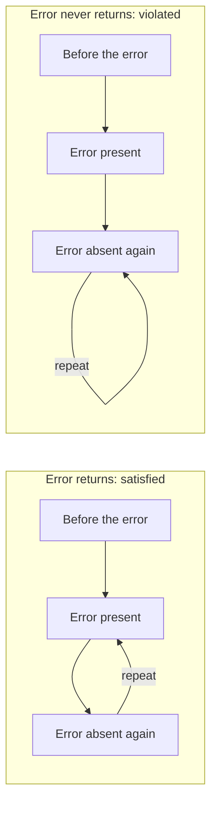

# Check whether a trace satisfies a model

An [instance check](instance-checks.md) asks whether one configuration obeys a
model. Behavioral Clafer also describes what may happen over time. A **trace**
is an ordered sequence of configurations. Each configuration can be structurally
valid while the history still violates a rule—for example, an event that must
eventually happen might never occur.

## What the trace checker checks

The Haskell and Lean compilers translate behavioral models into temporal Alloy.
Alloy can find a trace satisfying a translation. The Lean semantic checker asks
whether that particular trace satisfies the formal Clafer rules, independently
of what the translation says.

It checks both kinds of obligation:

- **Structure and identity:** each snapshot has valid objects and links, and
  objects retain their identities, types and containment parents across time.
- **Behavior:** the sequence of snapshots satisfies the attached temporal rules.

The exercise compares that judgment with both compilers' Alloy translations on
the same trace. Agreeing about one snapshot is insufficient when a rule refers
to what happens later.

## Generated-trace walkthrough

Imagine a diagnostic test that exercises a device's error reporting. We want an
error to appear while the test runs. With descriptive names, the model reads:

```clafer
device ?
  diagnostic ?
    error ?
    [ F error ]
```

Indentation expresses containment; `?` means optional. `F` means **eventually**.
For this exercise the device and diagnostic test stay present throughout.
The constraint belongs to the diagnostic test and applies at every step: an
`error` child must be present now or at a later time.

This is stronger than asking whether an error occurred once. As long as the test
keeps running, each new moment has the same obligation. A permanently present
error satisfies it; an error that disappears forever does not.

## Why the loop matters

The solver represents continuing behavior with a finite sequence of snapshots,
called **frames**, and a final edge back to one of them. Repeating that loop gives
an infinite history, often called a **lasso**. The last frame is not the end of time.

Consider these two traces. The device and test remain present in every frame;
the diagrams show only whether the error is present:



In both histories, the error appears and then becomes absent. At **error absent
again**, the checker must decide whether an error will occur in the future:

- In **Error returns**, the loop reaches **error present**, so the obligation is met.
- In **Error never returns**, it repeats **error absent again** forever, so it is violated.

Seeing an error earlier in the trace cannot satisfy an obligation that starts
after it. The two histories contain the same stored snapshots; changing only the
loop changes the answer. These arrows represent time, not containment.

## What the exercise compares

The initial trace is generated by Alloy: no error at first, then an
error that remains present. The exercise checks that trace, then makes three
controlled changes. All four keep the device and test alive:

| Trace | Why it passes or fails | Lean checker and both Alloy translations |
| --- | --- | --- |
| Error appears and stays | Every moment has an error now or later | accept |
| Error never appears | The eventual-error obligation is never met | reject |
| Error disappears, then the loop brings it back | The later obligation is met across the loop | accept |
| Error disappears, then absence repeats forever | The later obligation is never met | reject |

Each Alloy query fixes the same complete trace, including its loop. Its SAT or
UNSAT result therefore accepts or rejects **that trace**. It is not a search for
a different history that could make the comparison pass.

## What this tells us

The example shows why checking behavior needs more than checking each snapshot,
and why a trace checker must retain the loop and object identities. Agreement
on these traces does not prove that a generator produces every valid behavior,
or that no behavior exists when a bounded search finds none.

The executable checker is connected by Lean proofs to the formal semantics for
this supported profile. Supplying the model and decoding external solver output
remain tested boundaries. The [technical contract](temporal-runtime.md) records
the exact assumptions and the pairing of Haskell source with the resolved model.
For the broader conceptual picture, read
[From structure to behavior](https://github.com/kbak/clafer-semantics/blob/bbf81e44beca6eb6c4ff3f0e87516b15be59676e/docs/structure-and-behavior.md).

## Try the example

After the [tool setup](../CONTRIBUTING.md#setup-and-validation), choose a fresh
output directory and run:

```sh
python3 scripts/comparison/temporal_compare.py walkthrough \
  tests/fixtures/behavioral-cli/case.json /tmp/temporal-walkthrough-UNIQUE \
  --tools "$CLAFER_TEMPORAL_TOOLS"
```

The command generates the initial trace and checks all four cases above. The
[fixture mapping](temporal-runtime.md#walkthrough-fixture) connects the descriptive
names to the runnable input; understanding the verdicts does not require opening
its generated files.
