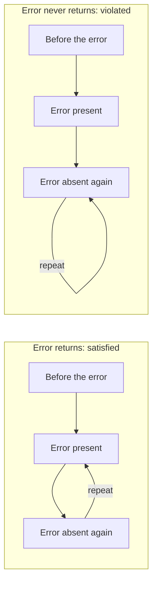

# Validate a generator's traces

An [instance check](instance-checks.md) tests one generated configuration. When a
generator produces behavior over time, we need to check its whole **trace**: an
ordered sequence of configurations. Every individual configuration could be
valid while the execution violates the model—for example, a required event
never happens.

The practical exercise is the same as for [Choco instances](choco.md): generate
an answer, check it against Clafer's formal semantics, then introduce a mistake
and confirm rejection. Here Alloy generates the answer. The Choco adapter
currently handles static instances only.

## What the checker needs

The trace checker needs the resolved model, the objects and links present at
each step, and how the trace continues after its last stored step. Object
identities must be consistent across the whole history: an object that persists
from one step to the next must remain the same object in the exported trace.

It checks both kinds of obligation:

- **Structure and identity:** each snapshot has valid objects and links, and
  objects retain their identities, types and containment parents across time.
- **Behavior:** the sequence of snapshots satisfies the attached temporal rules.

As with instance checking, the formal checker and the compilers play different
roles. Haskell and the Lean compiler translate the model into temporal Alloy;
the semantic checker evaluates the supplied trace against the formal rules.
The exercise asks all three about the same complete history.

## Generated-trace walkthrough

Consider a test mode for a device's error reporting. Whenever the test mode is
active, an error must occur now or later in the chosen execution. The small model is:

```clafer
device ?
  diagnostic ?
    error ?
    [ F error ]
```

Indentation expresses containment; `?` means optional. `F` means **eventually**.
For this exercise one `device` and its `diagnostic` child stay present throughout.
The constraint belongs to `diagnostic` and applies at every step it is present:
an `error` child must be present now or at a later time in this trace.

This is stronger than asking whether an error occurred once. As long as the test
keeps running, each new moment has the same obligation. A permanently present
error satisfies it; an error that disappears forever does not.

## Why the loop matters

The solver represents continuing behavior with a finite sequence of snapshots,
called **frames**, and a final edge back to one of them. Repeating that loop gives
an infinite history, often called a **lasso**. The last frame is not the end of time.

Consider these two traces. The device and test remain present in every frame;
the diagrams show only whether the error is present:



In both histories, the error appears and then becomes absent. At **error absent
again**, the checker must decide whether an error will occur in the future:

- In **Error returns**, the loop reaches **error present**, so the obligation is met.
- In **Error never returns**, it repeats **error absent again** forever, so it is violated.

Seeing an error earlier in the trace cannot satisfy an obligation that starts
after it. The two histories contain the same stored snapshots; changing only the
loop changes the answer. These arrows represent time, not containment.

## What the exercise compares

The initial trace is generated by Alloy: no error at first, then an
error that remains present. The exercise checks that trace, then makes three
controlled changes. All four keep the device and test alive:

| Trace | Why it passes or fails | Lean checker and both Alloy translations |
| --- | --- | --- |
| Error appears and stays | Every moment has an error now or later | accept |
| Error never appears | The eventual-error obligation is never met | reject |
| Error disappears, then the loop brings it back | The later obligation is met across the loop | accept |
| Error disappears, then absence repeats forever | The later obligation is never met | reject |

Each Alloy query fixes the same complete trace, including its loop. Its SAT or
UNSAT result therefore accepts or rejects **that trace**. It is not a search for
a different history that could make the comparison pass.

## Use this when developing a behavioral generator

The last two cases form a useful test for a generator integration: their stored
snapshots are identical, but their correct verdicts differ. An adapter that loses
the loop cannot distinguish them. Checking the snapshots separately cannot
distinguish them either.

To apply the checker to another generator, its adapter must supply the resolved
model and preserve the returned trace's identities, states and continuation.
Start with a rule such as `F error`, a satisfying trace, and a trace that violates
it. The existing exercise demonstrates this connection for Alloy output; it
does not yet provide a temporal adapter for the Java Choco backend.

Acceptance establishes that the supplied trace satisfies the supplied model in
the supported profile. It does not show that a generator finds every valid
behavior or that no behavior exists when a bounded search finds none.

The executable checker is connected by Lean proofs to the formal semantics for
this supported profile. This walkthrough uses a reviewed pair of Haskell source
and resolved model; it does not independently check that a new parser produces
the right model. Decoding external solver output also remains a tested boundary.
The [technical contract](temporal-runtime.md) records these assumptions.
For the broader conceptual picture, read
[From structure to behavior](https://github.com/kbak/clafer-semantics/blob/bbf81e44beca6eb6c4ff3f0e87516b15be59676e/docs/structure-and-behavior.md).

## Run the exercise

After the [tool setup](../CONTRIBUTING.md#setup-and-validation), choose a fresh
output directory and run:

```sh
python3 scripts/comparison/temporal_compare.py walkthrough \
  tests/fixtures/behavioral-cli/case.json /tmp/temporal-walkthrough-UNIQUE \
  --tools "$CLAFER_TEMPORAL_TOOLS"
```

Successful completion means the generated trace and the recurring-error trace
were accepted, and both traces without a future error were rejected. The
[fixture mapping](temporal-runtime.md#walkthrough-fixture) connects the descriptive
names to the runnable input.
