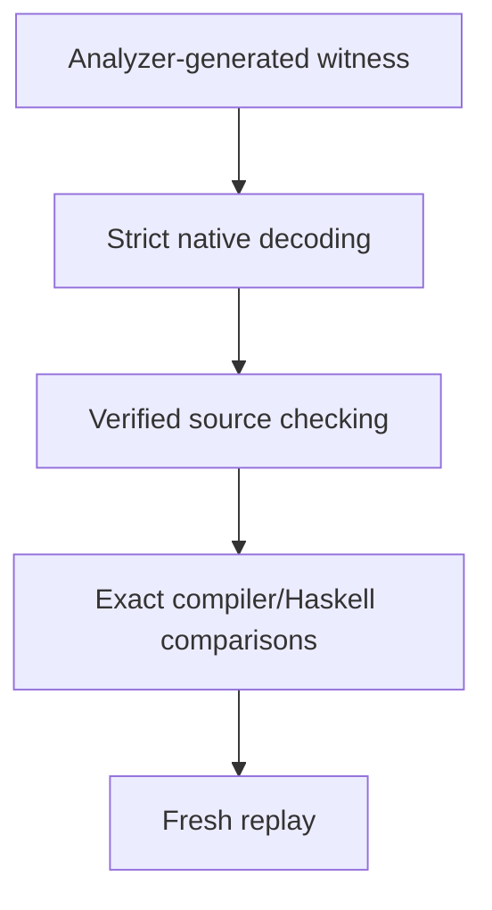
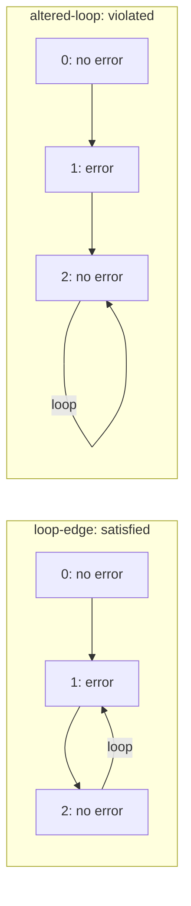

# Check whether a trace satisfies a model

An [instance check](instance-checks.md) asks whether one configuration obeys a
model. Behavioral Clafer also describes what may happen over time. A **trace**
is a sequence of configurations: objects may appear or disappear, and references
may change. A trace checker must check the history as well as its individual
configurations.

For example, a model can require an event to occur eventually. Every snapshot
could be structurally valid while the event never happens. The walkthrough below
generates a trace, checks that obligation, then changes the trace to show why it
fails. The conceptual guide
[From structure to behavior](https://github.com/kbak/clafer-semantics/blob/bbf81e44beca6eb6c4ff3f0e87516b15be59676e/docs/structure-and-behavior.md)
explains how configurations, identities and obligations fit together.

## Generated-trace walkthrough

This small model describes a machine containing a context, `ctx`, where an
`error` event can be present:

```clafer
machine ?
  ctx ?
    error ?
    [ F error ]
```

Indentation expresses containment; `?` means optional. `F` means **eventually**.
For this exercise we keep the machine and context present throughout. The
constraint belongs to `ctx` and applies at every step: an `error` child must
be present now or at a later time. One past event does not satisfy all future
obligations.

To represent continuing behavior in finite output, the solver returns a few
snapshots, called **frames**, and a final edge back to one of them. Repeating that
loop describes an infinite history, called a **lasso**. The loop is part of what
we check: an event-free last frame may lead back to a future event, or repeat
forever without one.

### Run the example

After the [pinned tool setup](../CONTRIBUTING.md#setup-and-validation), run from
the repository root, choosing a fresh external output directory:

```sh
python3 scripts/comparison/temporal_compare.py walkthrough \
  tests/fixtures/behavioral-cli/case.json /tmp/temporal-walkthrough-UNIQUE \
  --tools "$CLAFER_TEMPORAL_TOOLS"
```

The Alloy Analyzer generates the initial trace. The Lean checker evaluates it
against the source semantics. We then ask both the Lean and reference Haskell
Alloy translations about that exact trace, and replay the checks from saved data.
In the results below, SAT accepts the fixed trace and bounded UNSAT rejects it;
rejection does not mean that the model has no other valid trace.



### Read the results

Frames are numbered from zero. The first two cases show an event that arrives
and one that never arrives. The next pair keeps the same three frames but changes
where the final edge goes, so only one history continues to reach an event.

| Example | `error` present by frame | Final edge | Source check | Both exact targets |
| --- | --- | --- | --- | --- |
| `event-later` | no, yes | `1 → 1` | satisfied | SAT |
| `event-never` | no, no | `1 → 1` | violated | bounded UNSAT |
| `loop-edge` | no, yes, no | `2 → 1` | satisfied | SAT |
| `altered-loop` | no, yes, no | `2 → 2` | violated | bounded UNSAT |

`event-never` removes the event from that decoded trace without deleting its
identity. `loop-edge` appends an event-free frame and loops back to frame `1`.
The attachment is checked at every live context/time: the obligation at frame `2`
can reach its witness only across the loop edge. `altered-loop` changes only that
edge, leaving the context alive forever without another event. An event earlier
in the finite prefix cannot discharge this later obligation.

The frames are identical in these two cases; only the final edge changes.
Machine and context remain alive throughout.



### Source correspondence and bounds

The exercise uses an explicit [source/IR pair](../tests/fixtures/behavioral-cli/case.json).
IR is the resolved model representation consumed by the native command.
The constraint belongs to `ctx`, beside its `error` child. The pairing is explicit:
declarations `0/1/2/3` denote `root/machine/ctx/error`; attachment `40` has owner
`2` and body `["eventually", ["atom", ["inhabited", ["thisStep", ["child", 3]]]]]`.
Thus `error` navigates from the current `ctx` to its live children; it is not a
global event in a different context. This is a manual source/IR correspondence
premise for review, not a theorem about parsing Haskell source.

All examples keep the same root, machine and context present in every frame.
Parent cancellation therefore cannot discharge the eventuality. The static pool
contains four identities, exactly one per declaration, including the `error`
identity when absent. The bitwidth is `8`; it bounds structural counts and adds no
arithmetic observation. Each query fixes the stored-frame count: `2..2` for the
first two cases above, `3..3` for the last two.

The generator query compiles the paired IR and invokes the external Analyzer
without candidate tables or the exact-fixing clock. Its retained `scenario.als`
keeps machine/context present, requires no initial error and a permanent error
from the next frame. With exactly two frames those observations force loop `1`.
These scenario restrictions select one witness; they do not establish that the
compiler can generate every satisfying trace. The Analyzer chooses the atoms,
types and parent tables, and its actual raw output goes directly through the
strict native decoder and independent evaluator. The decoded result then becomes
the supplied candidate for exact compiler/Haskell comparison.

### Saved results and additional checks

Under `walkthrough/`, `generation/` retains the compilation, scenario, request,
raw `solver.json`/`result.json`, JVM receipts/stdout/stderr, checker input/output and
decoded `candidate.json`. Each named example is an ordinary hashed comparison
bundle with paired Haskell source/IR/Alloy, generation receipt, bounds, source and
tool identities, exact target queries and full observations. A sibling `*-replay/`
is a fresh verified replay of that bundle. The top-level `runtime.json` and
`evidence-index.json` bind the complete walkthrough; the command's JSON summary
keeps source verdicts and target outcomes separate. The existing `replay` command
can rerun any individual named bundle. No historical receipt qualifies new bytes.

The walkthrough also submits truncated frames, changed field metadata and an
out-of-range loop from the actual raw witness, requiring `malformed` each time.
The wider regression corpus separately checks static parents/types, repeated
reference heads, one global renaming and rejection of stuttering. This basic
fixture has no references; it does not substitute for that reference corpus.
Unsupported inputs and operational failures cannot become bounded UNSAT or a
successful walkthrough. Checking these supplied lassos establishes neither
generator completeness nor unbounded UNSAT. The proof and native/serialized
boundaries below apply unchanged; no full-arithmetic or Python-observer assurance
is claimed.

## Native command and input schemas

The resolved runtime connects the [encoding](behavioral-encoding.md) to strict
native input, Analyzer trace decoding and independent exact-candidate checks.
The selected profile is `behavioral-core/1`; primitive integer observations and
full-source qualification retain their separate owners. Integer bitwidth still
bounds emitted structural counts. Static commands and reference profiles keep
their contracts.

```sh
lake build clafer-compiler
.lake/build/bin/clafer-compiler compile-behavioral-ir \
  tests/fixtures/behavioral-cli/input.json \
  --bounds tests/fixtures/behavioral-cli/bounds.json --output /tmp/behavioral.als
```

`--format alloy` is the default. `--format json` emits the compilation envelope
below. File/stdin/stdout handling, `--objects`, `--bitwidth`, atomic output and
`--diagnostics text|json` use the [native CLI contract](cli.md). Both bounds files
and overrides remain explicit; there is no solver dispatch or scope inference.
The executable and its shared-library closure suffice, as tested in an empty
Bubblewrap root without Lean, Haskell, Java or Alloy.

All JSON objects are closed and fields required, including explicit `null`
where allowed. Integers are canonical natural tokens; negative, decimal and
exponent tokens and duplicate keys are rejected. UTF-8 and surrogate validation
use the existing strict decoder. Arrays below have exactly the shown arity.

`clafer-behavioral-ir/1` has fields `version`, `profile: "behavioral-core/1"`,
`structure` and `attachments`. `structure` is the complete guarded
[`clafer-ir/1`, `m1-effective` document](ir.md), including ranks and source metadata.
Each attachment is `{id, owner, kind: "constraint", body, source}`. Its ID is
unique; `owner` is an original declaration ID; `source` is `null` or the existing
logical-file/UTF-8-span schema. Only hard constraints are admitted.

The `body` grammar uses tagged arrays. `d` denotes an original declaration ID,
`i` a zero-based lexical index (`0` is the innermost binding), `s` a set expression,
`a` an atom and `f` a formula:

| Family | Constructors |
| --- | --- |
| Navigation | `["parent"]`, `["child", d]`, `["deref", d]` |
| Sets | `["empty"]`, `["this"]`, `["root"]`, `["var", i]`, `["extent", d]` |
| Set operations | `["union", s, s]`, `["inter", s, s]`, `["diff", s, s]`, `["step", navigation, s]`, `["thisStep", navigation]` |
| Atoms | `["inhabited", s]`, `["equal", s, s]`, `["subset", s, s]` |
| Formula leaves | `["truth"]`, `["atom", a]` |
| Unary formulas | `[op, f]` for `not`, `next`, `eventually`, `always`, `initially`, `finally` |
| Binary formulas | `[op, f, f]` for `and`, `or`, `implies`, `iff`, `xor`, `strongUntil`, `weakUntil` |
| Conditional | `["ite", f, f, f]` |
| Binders | `["quant", q, s, f]` with `q` in `all`, `some`, `no`, `one`, `lone`; `["letSet", s, f]` |

Binders extend the body's lexical environment. Input construction retains proved
traversal budgets; it does not ask users to supply proof fuel. Unknown IDs,
out-of-range indices, extra operands and duplicate attachment IDs are malformed.
Unsupported constructors, kinds or profiles are rejected. Primitive observations,
arithmetic, modifiers, transitions and full source frontend compilation are outside
this command's profile.

`clafer-behavioral-bounds/1` has `version`, `objects`, `bitwidth`, `declarations`,
`minSteps`, `maxSteps`. `declarations` lists exactly one `{id, size, exact}` per
original declaration ID. Object capacity bounds the entire trace-wide pool;
declaration scopes bound static type pools, including identities absent from
every frame. `1 ≤ minSteps ≤ maxSteps`; backend admission checks bitwidth `1..16`
and conservative count ranges. Contradictory but safe scopes can compile to
unsatisfiable text. Step bounds describe stored lasso length, not a finite end of
time. External Analyzer requests additionally retain the existing 100-step limit.

Diagnostics retain version `1`, category, code, phase and JSON-pointer location.
The native exit codes are `0` success, `1` operational, `2` malformed and `3`
unsupported. `behavioral.version`, `behavioral.profile` and `bounds.version`
identify unsupported schema versions; `behavioral.constructor` identifies
unsupported syntax; `behavioral.metadata` identifies invalid attachment identity
or ownership. Structural, strict JSON and `bounds.declarations`/`bounds.unsafe`
codes retain their [existing meanings](cli.md). Internal target/serialization
failures use `compiler.target`/`compiler.render`. No failure pre-truncates output.

## Compilation and trace output

`Driver.Behavioral.compileText` returns checked text, the compiled module and
generated byte mappings. `Product.json` exposes:

| Field | Meaning |
| --- | --- |
| `version`, `profile` | `clafer-behavioral-compilation/1`, `behavioral-core/1` |
| `alloy` | Deterministic checked Alloy text |
| `declarations` | `{id, name, signature, referenceField}`; reference field is `null` for basic declarations |
| `signatures` | Map from `this/name` to `{mutable, parent, abstract}`; top-level parent is `univ` |
| `fields` | Map from `this/owner/name` to `{mutable, arity: 2}` |
| `scopes` | Map from each signature name to `{count, exact}` |
| `bitwidth`, `minSteps`, `maxSteps` | Admitted explicit command bounds |
| `attachments` | Preserved attachment IDs |

`Driver.BehavioralTrace.decode` accepts the compiled structural layout and the
actual bridge trace JSON: `{length, loop, inventory, frames, signatures, fields}`.
`inventory` contains unique opaque atom labels; each frame has `signatures`
(unary tuple arrays) and `fields` (binary tuple arrays) with exactly the compilation
schema's table names. Signature/field metadata must match that schema. The full
object pool must equal the inventory in every frame. Frame count must equal
`length > 0`, and `0 ≤ loop < length`. Duplicate tuples are malformed; row order
is immaterial. Static tables cannot change across frames. The decoder delegates
the final data validation to `Backend.Alloy.Behavioral.decode`, which checks
re-encoding without assuming source satisfaction. Decoder diagnostics use
`behavioral.trace` or the strict shape/JSON diagnostic that failed first.

`Driver.BehavioralTrace.json` exports `clafer-behavioral-trace/1` with `profile`,
`root`, `length`, `loop`, `identities`, `frames` and `integerObservations: []`.
Each identity is `{id, type, parent}`; `type` is the original declaration ID,
`parent` is an identity ID or `null`. Each frame is `{live, references}` with
identity IDs in `live` and `[declarationID, headID, targetID]` reference rows.
Heads remain separate even when their targets coincide. Atom labels are sorted
once into a stable numeric inventory; witness comparison permits one global
identity renaming while retaining type/parent and all indexed frame data.
Nonempty integer observations are explicitly unsupported in this profile.

The test checker emits `clafer-behavioral-check/1`: `status`, `structural`,
per-attachment `{id, satisfied}` rows, and the decoded `trace`. Malformed or
unsupported native input instead produces `status` and a versioned diagnostic.

## Exact comparison and retained replay

```sh
python3 scripts/comparison/temporal_compare.py run \
  tests/fixtures/behavioral-cli/case.json /tmp/temporal-run-UNIQUE \
  --tools "$CLAFER_TEMPORAL_TOOLS"
python3 scripts/comparison/temporal_compare.py replay \
  /tmp/temporal-run-UNIQUE/case /tmp/temporal-replay-UNIQUE \
  --tools "$CLAFER_TEMPORAL_TOOLS"
```

The case schema is `{version: "clafer-temporal-case/1", document, bounds, source,
uids, candidate, seed}`. `document`/`bounds` use the native schemas; `candidate`
uses the decoded source trace schema. `source` is the paired Haskell source;
`uids` maps decimal original declaration IDs to paired-export UIDs, including
the explicit `root`. `seed` is a natural retained provenance value.

The historical adapter admits concrete, noninherited declarations with basic,
set or bag object references and no modifiers. It validates the whole explicit
UID map, names, containment, effective intervals and qualified reference paths
against fresh paired JSON/Alloy output. The source and typed IR formulas must be
reviewed equivalents; automatic full-source elaboration/correspondence belongs
to the later frontend qualification. Historical exporter failures, including its
standalone `let` desugaring failure, remain operational results. The supported
quantified fixtures exercise frozen identities. Other Haskell profiles and
original-versus-explicit comparison are not admitted here.

Each query fixes every static/mutable table under frozen global object aliases.
A separate singleton phase per stored frame and a mutable clock force the exact
successor graph and final loop edge. Both solvers run with exactly the candidate's
length and the user's original identity scopes/bitwidth; auxiliary clock scopes
are recorded separately. SAT output must have the same phase/loop, metadata and
whole-trace global isomorphism after removing only the clock atoms. The retained
original Alloy still contains the exporter's effective command/options/scopes;
the bridge's explicit fixed-candidate request is separately recorded. Root absence
is explicitly impossible in the historical encoding, never silently replaced by
a live root. Different state counts, loop indices and stuttering presentations
are unequal even if they denote the same infinite observation sequence.

The result contains `status`, source satisfaction, each target's `status` and
`outcome`, discrepancy `directions` and `haskell_profile`. A completed query pair
can have `source-only` (source satisfies, target bounded UNSAT) or `target-only`
(source violates, target SAT) discrepancies for either backend. `inconclusive`
retains target errors/resource limits/timeouts; native schema failures remain
`malformed`/`unsupported`, and process failure/timeout remains `error`/`timeout`.
None is a bounded UNSAT result. SAT is a witness for this exact candidate;
bounded UNSAT is its absence within this fixed presentation and scopes.

Every run retains source and IR, original/fixed Alloy, requests, stdout/stderr,
generation receipts, native/compiler/tool hashes, full observations and a hashed
artifact inventory outside source. Replay rejects changed or added artifacts,
changed source, native binaries or tool/profile identities before accepting
fresh equal outcomes. `minimize BUNDLE OUTPUT --tools TOOLS` performs the row
reduction described in the [reuse assessment](#reuse-assessment) and writes a
replayable `minimal` bundle. Test-only
`reject-all` and `drop-attachments` mutations are explicit settings retained in
replay; they test detection of both directions without claiming real compiler
defects.

## Proof and test boundaries

`SemanticsBridge.Behavioral.Verification.toSet_eq` and `lower_eq` identify the
executable adapters with the independent upstream set interpretation and lowering.
`sourceLasso_tables` preserves stored observations and the loop with no validity
assumption. `attached_correct` equates executable normalized finite attachment
checking with upstream `Formula.Attached` over the supplied lasso unfolding.
It requires only the formula traversal bound, uses the proved total-set finite
adapter, and includes upstream's history-aware treatment of birth/end anchors.
Structural checking uses upstream `Verification.checkAt` with the interpreted
model/certificate and the same source lasso. Source truth is not obtained from
target truth or the compiler's lowering.

These are kernel-checked in-memory statements. JSON parsing, native compilation,
serialization, exact Alloy query construction, solver execution and Python
orchestration are tested boundaries. The
[runtime corpus](../tests/test_temporal_comparison.py) covers lifetime cancellation
and negation, context replacement, reappearance, frozen quantified identities,
loop edges, repeated set/bag reference heads, deterministic constructor transport,
malformed frames, one global renaming, replay tampering, operational outcomes and
discrepancy sensitivity/minimization. Seed `78` also generates small two-frame
negative/positive candidates; it is a finite search, not exhaustive qualification.
The [runtime isolation test](../tests/test_cli_external.py) exercises the actual
native behavioral command. Static regressions, every-module builds, axiom auditing,
kernel replay and full IntentBond checking remain mandatory. Independent semantic
review remains pending until separately accepted.

## Reuse assessment

The native boundary reuses `Driver.StrictJson`, `Decode.Node`, structural ID
resolution, admission, diagnostics and atomic file output. Lean's JSON parser
alone loses duplicate keys and numeric token spelling, so it cannot replace the
existing strict wrapper. `Std.Internal.Parsec`, arrays, lists and dependent finite
indices supply the parser and collection machinery. Existing typed syntax and
backend compilation carry traversal-budget proofs; serialized construction must
retain those witnesses instead of introducing unchecked recursion or axioms.

`Backend.Alloy.Behavioral.decode` checks the in-memory tables and loop against
re-encoding. The external adapter must additionally validate the closed Analyzer
schema, all table names, tuples and one global atom inventory before constructing
those tables. The existing `AlloyTemporalBridge` exports complete frames and the
loop. Static comparison helpers supply subprocess receipts, content identities
and replay storage, but their single-state fixing cannot constrain a lasso.

Pinned upstream `Clafer.Behavioral.Verification` supplies finite lasso validity,
history-aware core evaluation and `FiniteAdapter.sets` with a proved agreement
theorem for the complete total-set grammar. Its mathematical normalization and
lowering are noncomputable; an executable adapter must establish correspondence
to those definitions before using the evaluator. No replacement source temporal
meaning or generic model checker is needed. The current partial-arithmetic
adapter remains unsupported.

The pinned historical Haskell exporter supplies paired source/IR/Alloy receipts.
Its static declaration pools and mutable containment fields require a checked
source-UID/name map, including its explicit `root` signature. Later PR113 comparisons require their own accepted
profile identity; historical discrepancy expectations cannot be transferred.
Alloy 6.2 public APIs supply actual finite traces and SAT4J execution. The harness
must fix every observation and the loop under one global renaming. Stuttering is
not an equivalence because `X` observes timing.

Python's standard JSON, hashing, subprocess and test libraries and the existing
Java adapter suffice for external orchestration. No new package or license cost
is introduced. New project code is MIT; imported Lean facilities remain Apache-2.0
and external tools retain the notices in the [source register](sources.md).
Native execution, JSON decoding, serialization and SAT solving remain tested
boundaries, separately from kernel-checked in-memory correspondence.

The generated-trace walkthrough composes these same APIs: `temporal.solve`,
`Runtime.check`, `Runtime.compare` and `replay_case`, with the existing
`behavioral-cli/case.json` fixture. A short scenario selects an illustrative
Analyzer run; it needs neither another model checker nor another trace protocol.
Python's existing standard-library orchestration suffices. The verified total-set
adapter remains authoritative; the full-source Python observer is not used.

Exact witness comparison reuses the pinned static `relation.isomorphism`: tag
memberships and reference relations by frame index and keep static type/parent
rows in the same graph. Its single global bijection then preserves every frame;
frame count and loop are checked separately. Independent per-frame graph matching
would lose replacement. A private phase clock in the fixed Alloy query gives each
stored position a distinct observation and forces the final edge to the requested
loop. Its atoms are separate from the source pool and are checked before projection.
This avoids adopting a stuttering or alternate-presentation equivalence.

The upstream `candidates.shrink` implements a static-protocol deletion loop and
cannot represent frame indices or retain a temporal loop. The temporal reducer
uses that greedy strategy with live/reference rows as its reduction domain.
It retains the original bounds, static inventory, frame count and loop; it makes
no claim to minimize formulas, identities or lasso presentations. Each deletion
is accepted only after a fresh completed three-way comparison preserves the
entire discrepancy-direction list. Any inconclusive trial ends the reduction
without a minimality claim. This small adapter adds no minimization library.
